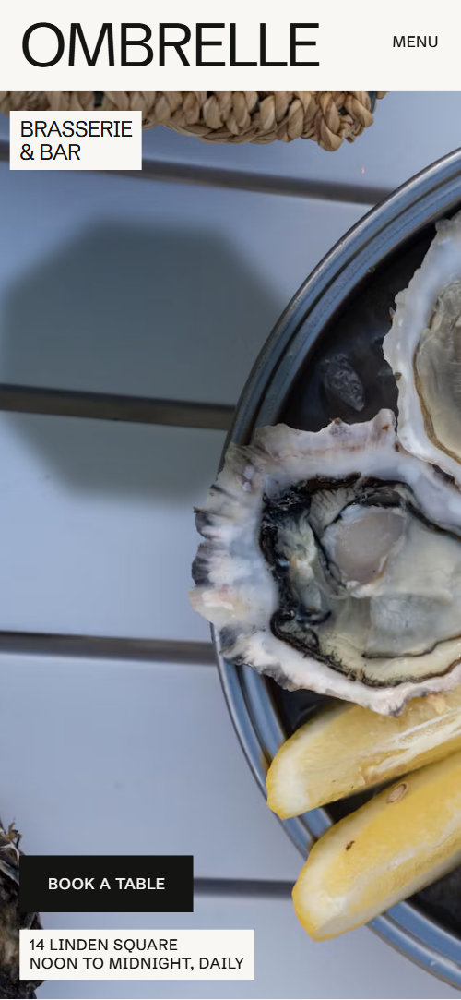

# Free HTML restaurant website template with GSAP scroll animations — Ombrelle

**Restaurant website for a brasserie, bistro or bar, with a menu, opening hours and table booking: a free HTML template in one file, with GSAP scroll animations, no build step, MIT license. Made by [8B](https://8b.com/), the AI website builder.**

[](LICENSE)  

**[Live demo](https://8bsite.github.io/restaurant-website-template/)** · **[Use this template](https://github.com/new?template_name=restaurant-website-template&template_owner=8bsite)** · **[Download ZIP](https://github.com/8bsite/restaurant-website-template/archive/refs/heads/main.zip)**

<a href="https://8bsite.github.io/restaurant-website-template/"></a> <a href="https://8bsite.github.io/restaurant-website-template/"></a>

<p align="center"><a href="https://8bsite.github.io/restaurant-website-template/"></a><br><sub>Scroll animation</sub></p>

A one-page site for a brasserie and bar on a town square, open from noon to midnight: menu with prices, the day's service times, the bar card, the seating areas and a booking form. Near-white, olive and night grounds with huge uppercase type; a parasol shade moves across the hero table, the page darkens from noon to midnight along a horizontal track and the parasols open on a plan of the house as you scroll.

Good for: brasserie, bistro or neighbourhood restaurant; café or bar with a terrace; seafood or market-driven kitchen with a daily menu; restaurant with lunch and dinner services and table booking.

## Use it with an AI coding agent

Download the files into your project (in Windows PowerShell type `curl.exe`):

```bash
curl -LO https://raw.githubusercontent.com/8bsite/restaurant-website-template/main/index.html
curl -LO https://raw.githubusercontent.com/8bsite/restaurant-website-template/main/AGENTS.md
curl -LO https://raw.githubusercontent.com/8bsite/restaurant-website-template/main/LICENSE
curl -LO https://raw.githubusercontent.com/8bsite/restaurant-website-template/main/CREDITS.md
```

Then give your agent this prompt:

```text
Read AGENTS.md, then edit index.html. Use this template as the base for a restaurant site for <your restaurant: name, kind of food, address, opening hours, menu with prices, how to book>. Keep the layout, the motion and the single-file format; replace the brand name, copy, menu, prices, hours, photos, links and contacts, and recolour it through the CSS variables if needed.
```

Give the agent the downloaded file, not a link: from a link it would rebuild a different page. No agent? Click **[Use this template](https://github.com/new?template_name=restaurant-website-template&template_owner=8bsite)**, edit `index.html` and turn on **Settings → Pages**.

## What's on the page

- **Navigation** — header: wordmark, five section links (Book a table last); compact bar on scroll up; phone menu overlay
- **Ombrelle** — first screen: huge wordmark, full-bleed dish photo, Book a table; then the menus intro and a photo pair (demo: brasserie and bar)
- **Lunch that runs into the evening** — olive full-width block: three-line justified heading and a short story
- **Ombrelle moments** — photo grid of six with a Follow us link (social feed)
- **Noon to midnight** — opening hours as a horizontal track of five services, ground going from day to night (demo: Lunch, Coffee hour, Aperitivo, Dinner, Last glass)
- **The brasserie card** — the menu: courses with dishes, short descriptions and prices, sticky course index and one photo
- **This morning** — five ingredients or suppliers with photos and where each goes on the menu (demo: the day's deliveries)
- **After five** — dark bar section: drinks and small plates with prices, two bar photos
- **Under the parasols** — seating areas with seat counts beside a drawn plan of the house, wide photo of the square
- **Said at the table** — three guest quotes set large, alternating sides
- **Book a table** — booking form and the restaurant's details (address, hours, phone, email)
- **Footer** — night footer: four link columns, width-filling wordmark, copyright and the Design: 8B credit

## Design

Palette:          
Fonts: Schibsted Grotesk (Google Fonts). Change both through the CSS variables in the `:root` block at the top of `<head>`. A big display line with `style="--len:N"` fills its width: set N to its new number of characters.

- The plan of the house in terrace is HTML and CSS (circles and outlines), not an image: change the number of parasols in the markup (the scene opens them four per row).

## Before you publish

- Replace everything marked `data-8b-placeholder` (social preview image, favicon, social, phone, email, form) and the invented demo facts: prices, dates, address. [AGENTS.md](AGENTS.md) lists them.
- The form sends nothing yet: connect it to Formspree or Netlify Forms, or remove it.

## Tech

GSAP 3.13.0, ScrollTrigger, SplitText, Lenis 1.3.11 from jsDelivr, 83 KB, no build step. Chrome and Edge 111+, Safari 16.2+, Firefox 113+ (it uses color-mix(), cascade layers, small/dynamic viewport units). With "reduce motion" on, the page is complete and still.

## License

MIT, see [LICENSE](LICENSE); the "Design: 8B" footer link is welcome, not required. Photos, fonts and libraries keep their own licences: [CREDITS.md](CREDITS.md). More free templates: [github.com/8bsite](https://github.com/8bsite).
